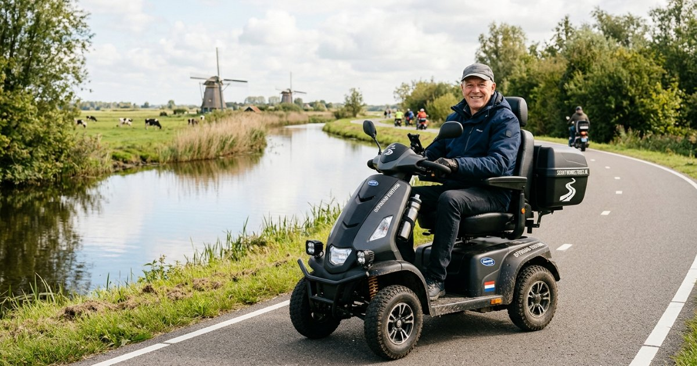

# Scootmobiel Hoorn




> **Live:** [scootmobieltocht-hoorn-nl.vercel.app](https://scootmobieltocht-hoorn-nl.vercel.app/) · Site ontwikkeld door [Stefan](https://raimonvibe.nl)

Een routeplanner voor scootmobielen in Hoorn en de dorpen eromheen (Zwaag, Blokker, Wognum, Schellinkhout, Wijdenes, Venhuizen, Berkhout, Hem en meer). Het is 100% frontend: **geen backend, geen API-sleutels, geen kosten**.

Gebouwd naar het voorbeeld van [amsterdam-metro-v2](https://github.com/raimonvibe/amsterdam-metro-v2): MapLibre met OpenFreeMap-tegels (Liberty in 3D, Licht, Donker) en dezelfde aandacht voor toegankelijkheid.

## Wat het doet

- 🗺️ **Routes over fietspaden en rustige straten**, uitgerekend in je eigen browser (A* over een vooraf gebouwd wegennet, binnen ~30 ms)
- 🚫 **Nooit trappen**, geen wegen waar fietsers niet mogen (een scootmobiel volgt de fietsregels), geen gras, zand of modder
- 🎨 **Kleur per soort pad** op de kaart en in een balk: fietspad, voetpad, woonstraat, drukke weg. Onverhard is gestippeld
- 📍 **Tussenstops**: kies dorpen, of klik op de kaart
- 🔁 **Rondjes**: kant-en-klare routes, zoals de dijkroute langs het Markermeer
- ▶️ **Volg route**: een stip rijdt de route af en de camera volgt mee. Dat staat uit bij "beweging verminderen"
- 🧭 **Routebeschrijving** per straat en een **deelbare link** (de route staat in de URL)
- ♿ Werkt ook **zonder kaart** (geen WebGL) als tekstversie, met een skip-link en toetsenbordbediening
- 🚧 **Hekjes, klaphekken, paaltjes en hoge stoepranden** uit OpenStreetMap: de route gaat er zo mogelijk omheen, en wat overblijft staat op de kaart (oranje = meestal te passeren, rood = vaak niet)
- 🚻 **Plekken onderweg**: toiletten, bankjes, supermarkten, apotheken en scootmobielwinkels. Klik erop om ze als tussenstop te gebruiken, of druk op **Toilet onderweg**
- 🌬️ **Wind en weer** (Open-Meteo): tegenwind of wind mee, met een waarschuwing bij harde windstoten of regen
- ✨ **Volg route** met een gloeiende stip en een vervagend spoor (deck.gl, net als de treinen op amsterdam-metro). Wordt pas geladen als je erop drukt
- ⭐ **Mijn routes**: favorieten en recente routes, alleen in je eigen browser
- 📲 **Installeerbaar als app** en **offline** te gebruiken: na één bezoek werken de planner en de kaartdelen die je al bekeek ook zonder internet
- ⌨️ **Sneltoetsen** (`/`, `V`, `O`, `T`, `B`, `K`, `?`, `Esc`); lettertoetsen zijn uit te zetten voor spraakbesturing
- 🛵 **Mijn scootmobiel**: kies klein, middel of groot; de rijtijd en aankomsttijd passen zich aan en worden onthouden
- ⏰ **Beste vertrektijd**: kijkt naar de wind en de kans op regen in de komende uren, bij daglicht
- 🏘️ **Wijken en buurten**: één keuzelijst, gegroepeerd per plaats, met bijvoorbeeld Kersenboogerd, Risdam en Grote Waal onder Hoorn, en Kreeklanden en Bloesemgaerde onder Wognum (officiële CBS-indeling via PDOK)
- 🗣️ **Goed voor te lezen**: op het scherm korte eenheden ("13 min", "2,5 km"); de voorleesknop en schermlezers krijgen een onzichtbare, uitgeschreven versie ("13 minuten", "2,5 kilometer")
- 📍 **Vanaf mijn locatie** starten, en een **routebeschrijving met herkenningspunten** ("bij de supermarkt") die je kunt laten **voorlezen**
- 🚫 **Leert van jou**: kon je ergens niet langs? Tik op de route, kies "Vermijd dit stuk", en de planner gaat er voortaan omheen. Of meld het direct op OpenStreetMap
- 📱 **Werkt op elk scherm**: op de telefoon schuift de planner als paneel over de kaart (klein, half, helemaal open; met knoppen of vegen); op tablet en computer een zijpaneel
- 🔎 **Plaats zoeken**: tik op Van of Naar en typ een deel van de naam ("kers" → Kersenboogerd), of kies uit de lijst per plaats
- 🎨 **Eigen kleurige iconen** met kleurverloop in plaats van emoji, overal hetzelfde
- 🌍 **Een Nederlandse website die goed te vertalen is**: wie de pagina via Google, Chrome of Safari vertaalt, krijgt alle tekst vertaald, behalve plaats- en straatnamen (anders wordt "Hoorn" "Horn" en "Nieuwe Steen" "New Stone"). De opmaak buigt mee met langere vertalingen (getest met Oekraïens, tot 30% langer) en voorlezen gebruikt dan een stem in de vertaalde taal
- 🗣️ **Offline voorleesstem**: de stem van je eigen telefoon; je kiest een vrouwen- of mannenstem, of op telefoons met maar één stem (zoals de meeste Android-telefoons) een hogere of lagere stem
- 🏙️ **Start bij punt A**: de kaart zoomt in op het vertrekpunt, schuin, zodat je de 3D-gebouwen ziet. **Hele route** toont het overzicht
- 🌦️ **Weer voor onderweg**: het weerbericht voor 24 uur wordt bewaard als je online bent, zodat je het zonder internet nog hebt
- ♿ **Toegankelijk**: tekst vanaf 17 px, knoppen van 48 px, alles met toetsenbord en schermlezer te bedienen, rekening met "beweging verminderen" en hoog contrast; gecontroleerd met axe (WCAG 2.2 AA)
- 🎬 Een **fly-in** bij het openen en **kaartstijlen in 3D** (Kleur, Helder, Licht, Donker, Fjord), plus **Kleur (2D)** als platte terugval voor oudere of tragere apparaten

## Delen op social media

Wie de link deelt (WhatsApp, Facebook, LinkedIn, X), ziet een voorbeeld met de foto uit `public/img/delen.jpg` (1200×630). De teksten staan in de `og:`- en `twitter:`-tags bovenin `public/index.html`.

## Hoe het gratis blijft

| Onderdeel | Waar | Kosten |
|---|---|---|
| Pagina + routenetwerk (~450 KB gzip) | GitHub Pages (of Cloudflare Pages / Netlify) | gratis, statisch |
| Kaarttegels | OpenFreeMap, direct vanuit de browser van de bezoeker | gratis, geen sleutel |
| Weer | Open-Meteo, direct vanuit de browser | gratis, geen sleutel |
| MapLibre | unpkg CDN | gratis |
| Routeberekening | de browser van de bezoeker | gratis |

Er draait niets dat kan slapen of omvallen. Zolang GitHub Pages en OpenFreeMap online zijn, is de site in de lucht.

## Lokaal draaien

```bash
python3 -m http.server 5190 -d public
```

Open dan http://localhost:5190.

## Online zetten (GitHub Pages)

1. Push deze map naar een nieuwe GitHub-repo (branch `main`)
2. Ga naar **Settings → Pages → Source: GitHub Actions**
3. `.github/workflows/pages.yml` publiceert `public/` bij elke push

## Na een wijziging online zetten

Verhoog `VERSION` in `public/sw.js` als je de app-bestanden verandert. Dan halen bezoekers die de app offline hebben de nieuwe versie op.

## Kaartdata verversen

Het wegennet komt uit OpenStreetMap en staat als statisch bestand in `public/data/`. Verversen doe je af en toe, op je eigen computer:

```bash
./scripts/fetch-osm.sh          # downloadt het gebied via Overpass en de CBS-wijken via PDOK (kan even duren)
node scripts/build-graph.mjs    # bouwt public/data/graph.json, places.json, pois.json en areas.json
```

Wil je een groter gebied? Pas de tegels in `fetch-osm.sh` en `maxBounds` in `public/app.js` aan.

## Bestanden

- `public/index.html`, `style.css`: de pagina
- `public/app.js`: kaart, bediening, routebeschrijving, deellink
- `public/router.js`: het wegennet laden, klikken naar het dichtstbijzijnde pad snappen, A*, obstakels
- `public/pois.js`, `weather.js`, `follow.js`, `saved.js`: plekken, wind en weer, Volg route, Mijn routes
- `public/sw.js`, `manifest.webmanifest`: offline en installeren als app
- `scripts/build-graph.mjs`: OSM-wegen naar een compacte graaf. Hier staat welke wegen een scootmobiel mag gebruiken

## Waarom zo?

De slimme functies zijn gekozen op basis van onderzoek naar wat rolstoel- en scootmobielgebruikers nodig hebben:
- Gebruikers ervaren obstakels verschillend per hulpmiddel ([CHI '25-enquête onder vijf groepen](https://makeabilitylab.cs.washington.edu/project/accessforwhom)), dus kies je je eigen scootmobiel.
- Gepersonaliseerde routes met barrières en voorzieningen, en terugkoppeling van gebruikers ([arXiv 2512.19898](https://arxiv.org/pdf/2512.19898)), dus kun je zelf stukken laten vermijden.
- Navigatie-apps missen vaak duidelijke herkenningspunten ([ÉTS, 2026](https://espace2.etsmtl.ca/33606/1/Montuwy-A-2026-33606.pdf)), dus noemen de aanwijzingen een herkenningspunt.
- Grote tikvlakken (48 px) en een eenvoudige tabbalk onderin werken beter voor ouderen.

## Bronvermelding

Kaartdata © [OpenStreetMap](https://www.openstreetmap.org/copyright)-bijdragers (ODbL) · tegels [OpenFreeMap](https://openfreemap.org/) · [MapLibre GL JS](https://maplibre.org/).

> Controleer de route ter plekke. OpenStreetMap kan afwijken van de werkelijkheid: denk aan opgebroken paden, paaltjes of hoge stoepranden.
